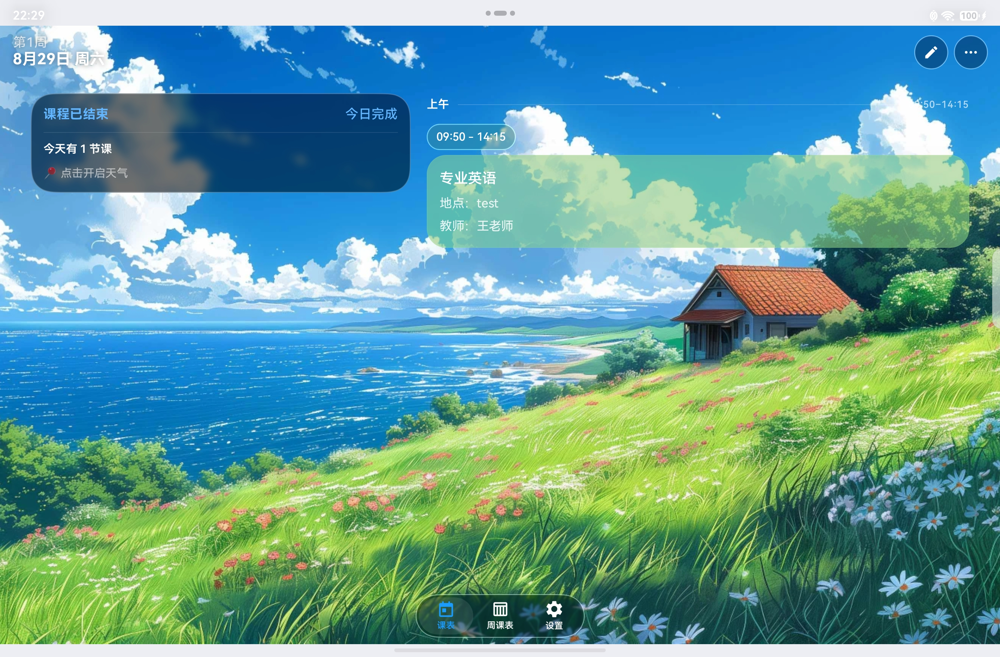
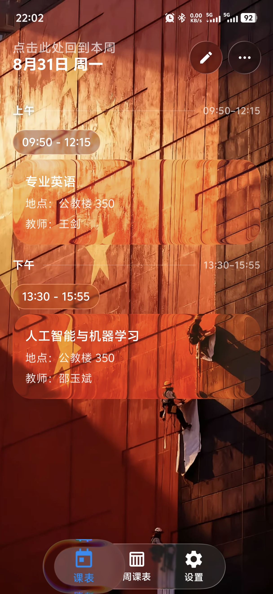
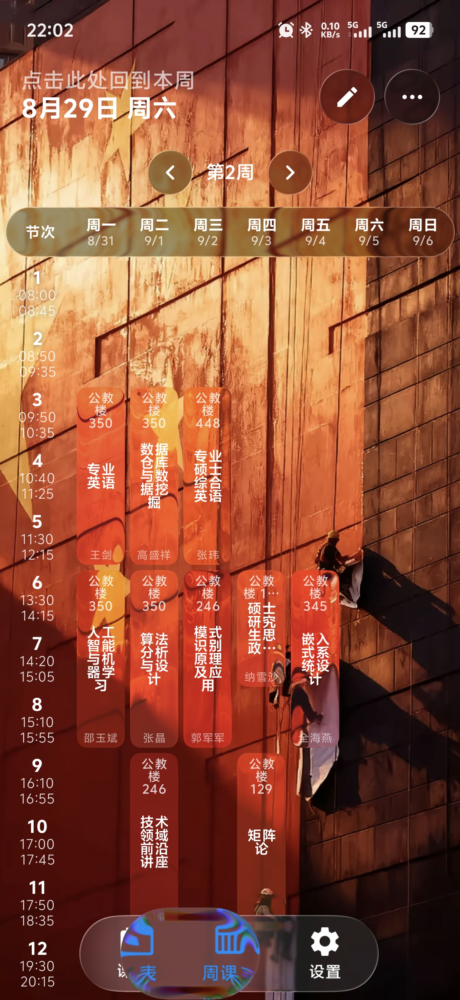
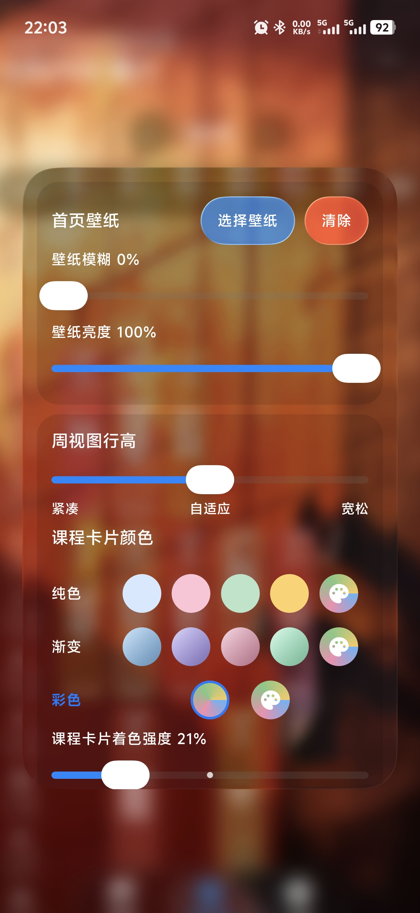
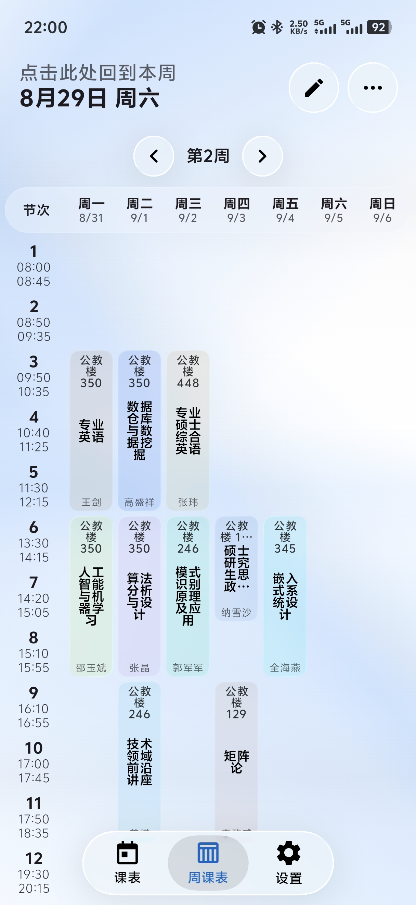
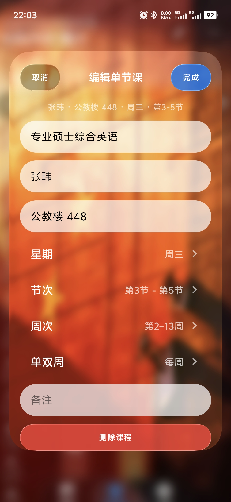
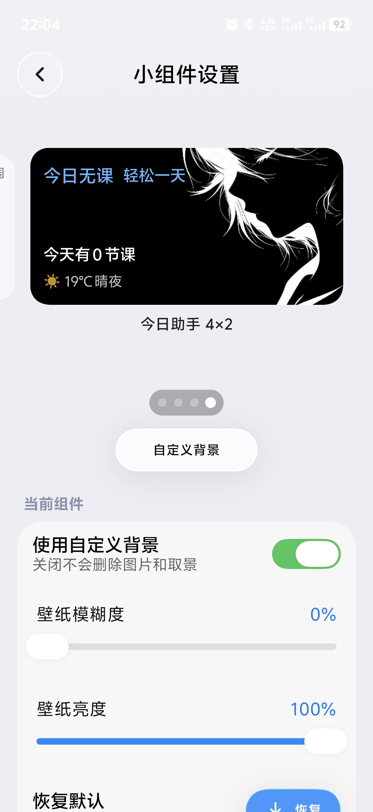
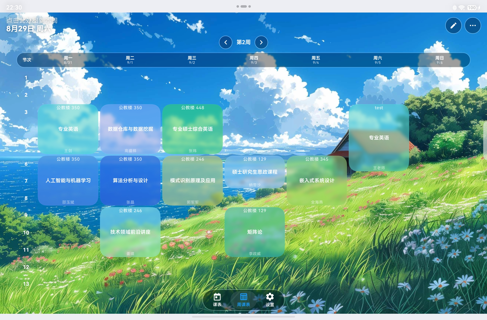

# LX 课程表

> 一款基于 Jetpack Compose 与 Miuix 构建，融合液态玻璃视觉效果和今日助手卡片的 Android 课程表。

> [!IMPORTANT]
> 本仓库是**源码可见项目，并非 OSI 定义的开源项目**。

LX 课程表围绕课表的导入、维护、提醒与日常查看进行设计，并提供桌面组件、今日助手和较完整的个性化能力。无需注册账号，课表、设置、壁纸与今日助手数据默认存储在设备本地。

应用使用 Jetpack Compose 构建，界面以 Miuix 与液态玻璃效果为基础，并针对壁纸背景下的可读性、动画连续性以及手机和平板布局进行了专门适配。视觉效果之外，项目同样重视数据迁移安全、长期存储占用和复杂课表场景下的稳定性。

当前版本为 **1.0.0**，最低支持 Android 8.0（API 26）。安装包可以通过 [GitHub Releases](https://github.com/Kerwin0126/L-Curriculum/releases) 下载。

## 界面预览

> 演示截图中的个性化壁纸来自 &#64;Rabbit_candy_i 与 &#64;kieed，仅用于展示应用界面效果，版权归原作者所有。如有侵权，请通过仓库 Issue 联系，将及时删除相关图片。

<p align="center">
  
</p>
<p align="center"><sub>平板日视图与内嵌今日助手</sub></p>

<table>
  <tr>
    <td align="center" width="33%"><br /><sub>周视图</sub></td>
    <td align="center" width="33%"><br /><sub>日视图</sub></td>
    <td align="center" width="33%"><br /><sub>液态玻璃个性化</sub></td>
  </tr>
  <tr>
    <td align="center" width="33%"><br /><sub>今日助手</sub></td>
    <td align="center" width="33%"><br /><sub>课程编辑</sub></td>
    <td align="center" width="33%"><br /><sub>桌面组件设置</sub></td>
  </tr>
</table>

<p align="center">
  
</p>
<p align="center"><sub>平板双栏设置页</sub></p>

## 它能做什么

### 课表

支持日视图与周视图，并可按学校实际安排配置学期日期、总周数和节次时间。课程既可按单周独立修改，也可批量更新同类课程；发生时间冲突时会先提示处理，而不会直接覆盖已有数据。当前教学周可根据开学日期自动推算。

### 导入

支持手动录入，以及粘贴 LX 课表口令、从 ICS 文件导入课表。所有导入结果都会先经过预览确认，再写入本地课表。

### 提醒和桌面组件

课程提醒支持自定义提前时间，并可在系统支持时通过实时活动展示上下课倒计时。项目提供今日课程与今日助手桌面组件，每个组件均可独立设置背景、取景、缩放、模糊和亮度。更新版本请从 GitHub Releases 或 Gitee 发行版下载。

### 今日助手

今日助手在日视图展示下一节课、实时倒计时、问候与可选天气信息；课程与倒计时均在本地计算，天气来自公开天气服务，不调用任何 AI 服务。

### 外观

首页壁纸支持横竖屏独立取景，课程卡片的配色、透明度、模糊和玻璃效果均可调整。手机与平板采用不同的自适应布局，大屏环境下会重新组织日视图、周视图、设置页和今日助手，而非简单拉伸手机界面。应用图标可固定为浅色或深色，也可跟随系统深色模式切换。

## 基本使用

首次使用时，在“设置 → 课表设置”中配置开学日期与节次时间，然后通过首页右上角添加或导入课程。若需使用课程提醒，还需要在通知设置中启用相关功能，并按照设备系统要求授予通知与后台运行权限。

> 实时活动的展示能力取决于手机厂商和系统版本。请以设备实际的通知权限、实时活动支持和后台限制为准。

## 数据与隐私

- 课表、设置、壁纸取景和今日助手偏好使用本地 Room 数据库或应用私有存储保存，不提供云同步。
- 卸载应用可能清除本地数据；重要课表建议保留原始导入文件或自行备份。
- 天气功能会把实现该功能所需的位置或坐标数据发送到公开天气服务；其余功能均在本地处理。

## 获取项目（仅供学习）

```bash
git clone https://github.com/Kerwin0126/L-Curriculum.git
```

- `main`：已验证的最新稳定代码。
- `v<版本号>`：正式发布版本标签，例如 `v1.1.1`。
- `feature/*`、`fix/*`、`release/*`、`codex/*`：短期开发分支，不作为长期下载入口。

## 项目结构

```text
CourseSchedule/
├── app/
│   ├── src/main/java/com/xiaomanjun/sleepdownschedule/
│   │   ├── app/                             # 应用装配、启动、顶层状态与页面宿主
│   │   ├── model/                           # 跨功能共享模型
│   │   ├── data/{local,repository}/         # Room、迁移、DAO 与 Repository
│   │   ├── domain/{course,schedule}/        # 无 UI 副作用的课程与课表规则
│   │   ├── core/                            # 身份、配置、性能、壁纸与通用 UI
│   │   ├── feature/                         # Home、导入、设置、组件等纵向功能
│   │   ├── glass/                           # 液态玻璃框架及 UI 适配
│   │   ├── transition/{legacy,...}/         # 统一转场与既有 Legacy renderer
│   │   └── *.kt                             # 稳定 Android 入口与兼容门面
│   └── src/test/ / src/androidTest/          # 单元测试、迁移和仪器测试
├── benchmark/                                # Macrobenchmark 与 Baseline Profile
├── docs/                                     # 版本说明、性能基线和节次方案文档
├── patches/miuix-0.9.3-sleepdown.patch      # Miuix 基础组合构建补丁
├── patches/miuix-cascading-popup-surface.patch
│                                           # 级联菜单玻璃表面扩展
├── THIRD_PARTY_NOTICES.md                    # 第三方代码与许可声明
└── gradlew / gradlew.bat                     # Gradle Wrapper
```

完整的包边界、入口映射与安全拆分规则见 [`docs/architecture/PROJECT_STRUCTURE.md`](docs/architecture/PROJECT_STRUCTURE.md)；通用界面复用约束见 [`SLEEPDOWN_DESIGN_SYSTEM.md`](docs/architecture/SLEEPDOWN_DESIGN_SYSTEM.md)。

## 技术栈

| 类别 | 主要实现 |
| --- | --- |
| UI | Jetpack Compose、Material 3、Miuix |
| 数据 | Room、KSP、Kotlin Serialization |
| 图形 | `kyant/backdrop`、自定义玻璃与动态模糊管线 |
| 导入 | ICS 解析、LX 口令编解码 |
| 通知 | Alarm、Foreground Service、实时活动兼容逻辑 |
| 桌面组件 | RemoteViews |
| 性能 | Macrobenchmark、Baseline Profile |

## 第三方项目与许可证

- [Kyant0/AndroidLiquidGlass](https://github.com/Kyant0/AndroidLiquidGlass)：液态玻璃目录组件基础，Apache-2.0。
- [compose-miuix-ui/miuix](https://github.com/compose-miuix-ui/miuix)：设置和手动导入页面组件，Apache-2.0。
- AndroidX、Jetpack Compose、Kotlin Serialization 等依赖遵循各自许可证。

本项目对第三方代码的引用和修改范围见 [THIRD_PARTY_NOTICES.md](THIRD_PARTY_NOTICES.md)。

## 开发协作

本项目部分代码分析、实现、测试与文档整理由 OpenAI Codex 协助完成，最终内容由项目作者审阅并发布。

## 许可证
